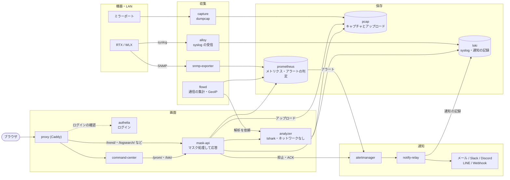

# GeoFront-NW

GeoFront-NW は宅内ネットワーク観測用の docker compose 一式です。ルーターやアクセスポイントから
SNMP・syslog・パケットを収集し、専用の司令室画面 (コマンドセンター) に表示します。
収集・保存・通知には定番の OSS (Prometheus、Loki、Alloy、Alertmanager) を利用します。マスク・解析・履歴再生・推移・ログ検索・ログインは、コマンドセンターと mask-api の追加機能です。
YAMAHA RTX / WLX 用のドライバが付属しています。他社機器にはドライバの追加で対応します ([docs/drivers.md](docs/drivers.md))。

## 機能

- 機器の状態・WAN の速度・インターフェースのエラーを SNMPv3 で収集
- syslog の受信・保存と、語句 (正規表現も可)・機器・重要度・期間による検索
- 通信量・エラー・通信先などの推移を最大 30 日分グラフ表示
- 通信先を 3D の地球儀に表示 (パケットキャプチャと GeoIP)
- アラートをメール / Slack / Discord / LINE / Webhook に通知し、画面から抑止や ACK が可能
- パケットをブラウザで解析 (IP / MAC はマスク表示)
- 過去時刻の再生と、証跡の zip 出力
- ネットワーク図の表示と、通信の急増・原因候補の一覧表示
- LAN への公開時は、ログインと HTTPS が必須

## 構成



収集と通知の矢印はデータの方向、画面の矢印は要求の方向です。ログインの確認は LAN への公開時と `OBS_AUTH=1` の場合のみ実施します。
デモでは機器とキャプチャの代替として demo-gen と flowd-demo が疑似データを出力します。コンテナ単位の役割は [docs/architecture.md](docs/architecture.md) を参照してください。

## 動作要件

- Linux (arm64 / amd64) または Raspberry Pi 4 (4 GB、64 bit OS)
- Docker Engine 25 以上と compose v2 (plugin)

ホストへの Python などの導入は不要です。設定作業は `tools` コンテナで実施します。

## デモ

デモは疑似データで動作するため、実機も設定ファイルも不要です。

```sh
git clone https://github.com/c-ardinal/GeoFront-NW.git && cd GeoFront-NW
docker compose --profile demo up -d --build
```

コマンドセンターは http://127.0.0.1:8080/ で表示します。
停止は `docker compose --profile demo stop`、データを含む削除は `down -v` です。

## 本番への導入

設定はリポジトリ外部の設定ディレクトリ `OBS_CONFIG_DIR` に配置します。既定の場所は `~/.config/geofront` です。
以下の手順では `docker compose` の代替としてラッパーの `./geofront` を利用します。

1. リポジトリを取得します。
   ```sh
   git clone https://github.com/c-ardinal/GeoFront-NW.git && cd GeoFront-NW
   export OBS_CONFIG_DIR=/etc/geofront      # 任意。root 権限が必要です (未指定の場合は ~/.config/geofront)
   ```
2. 初期設定を実施します。対話形式で `.env` と機器台帳を生成します。
   ```sh
   ./geofront run --rm tools init
   ```
   非対話で実行する場合の例です。
   ```sh
   ./geofront run --rm -e SNMP_V3_AUTH_PASS=... -e SNMP_V3_PRIV_PASS=... \
     tools init --yes --snmp-user obs --syslog-bind 192.168.100.10 \
     --device rtx1300,rtx,192.168.100.1 --device wlx413,wlx,192.168.100.2 --wan rtx1300:lan2
   ```
3. 機器側で SNMPv3 のユーザーと syslog の送信先を設定します ([docs/devices.md](docs/devices.md))。
   `--bind` に LAN 側の IP を指定して LAN に公開する場合は、ログイン用の利用者も作成してください。
   ```sh
   ./geofront run --rm tools user add yamada --role admin
   ```
4. 導入前の自己診断を実行します。NG の項目は、表中の対処方法に従って修正してください。
   ```sh
   scripts/doctor.sh
   ```
5. 起動します。
   ```sh
   ./geofront up -d --build
   ```
6. 動作を確認します。SNMP・syslog の受信・各サービスの health が全件 OK であれば完了です。
   ```sh
   ./geofront run --rm tools check
   ```

画面は `.env` の `OBS_PUBLIC_URL` (例 `https://192.168.100.10:8080`) で表示します。
LAN への公開時は、各端末にルート証明書を登録してください ([docs/security.md](docs/security.md))。

## 更新

```sh
./geofront run --rm tools backup --include-env
git pull && scripts/doctor.sh
OBS_COMMIT=$(git rev-parse --short HEAD) ./geofront up -d --build --remove-orphans && ./geofront run --rm tools check
```

イメージの取得を含む詳細手順は [docs/operations.md](docs/operations.md#更新) に記載しています。

## バックアップと復元

```sh
./geofront run --rm tools backup
./geofront run --rm tools restore backups/obs-backup-XXXXXXXX-XXXXXX.tar.gz
```

バックアップは `<設定ディレクトリ>/backups/` に生成します。復元前には対象サービスを停止してください。
停止対象のサービスと各オプションは [docs/operations.md](docs/operations.md#バックアップと復元) に記載しています。

## ドキュメント

| ドキュメント | 内容 |
|---|---|
| [docs/architecture.md](docs/architecture.md) | コンテナの一覧と役割、プロファイル |
| [docs/configuration.md](docs/configuration.md) | 設定ディレクトリ、`.env` の項目、`*_FILE`、機器台帳、通知先 |
| [docs/devices.md](docs/devices.md) | 機器側の設定例 (RTX / WLX の SNMPv3 と syslog、LLDP) |
| [docs/notifications.md](docs/notifications.md) | アラートの通知、抑止と ACK |
| [docs/security.md](docs/security.md) | LAN への公開とログイン、役割、証明書、利用者の管理、マスク |
| [docs/capture.md](docs/capture.md) | パケットのキャプチャと解析、GeoIP、プライバシー |
| [docs/operations.md](docs/operations.md) | 検証、自己診断、トラブルの対処、Raspberry Pi、リソース |
| [docs/ui.md](docs/ui.md) | 画面の操作方法 (Wallboard、コマンドセンター、履歴再生、証跡、ネットワーク図、原因候補) |
| [docs/drivers.md](docs/drivers.md) | 機種ドライバと他社機器の追加 |

## ライセンス

本体は MIT License ([LICENSE](LICENSE)) です。利用 OSS とデータは [THIRD_PARTY_NOTICES.md](THIRD_PARTY_NOTICES.md) に記載しています
(GeoIP: IP Geolocation by [DB-IP](https://db-ip.com)、CC BY 4.0)。YAMAHA / RTX / WLX は Yamaha Corporation の商標であり、本プロジェクトは同社と無関係です。
